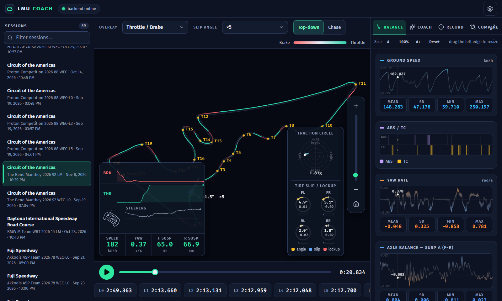
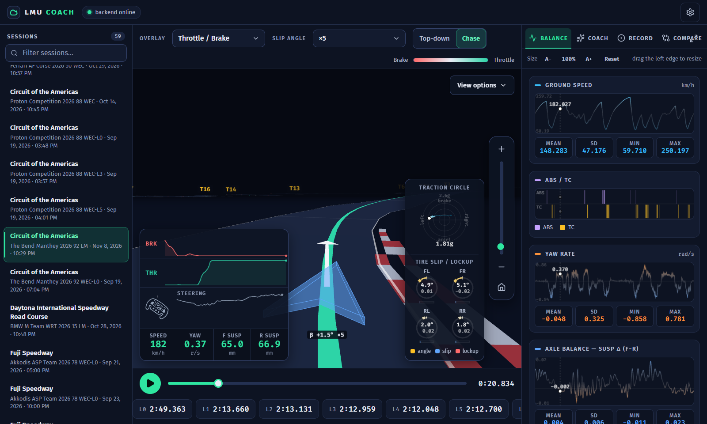
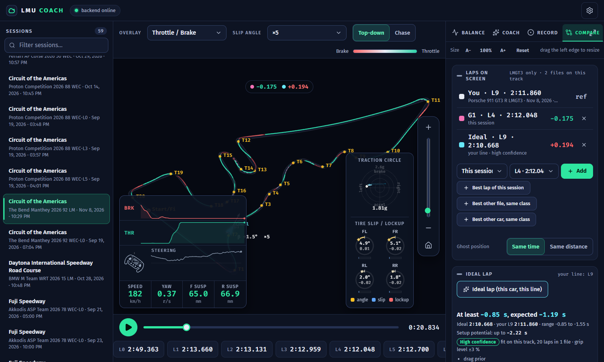
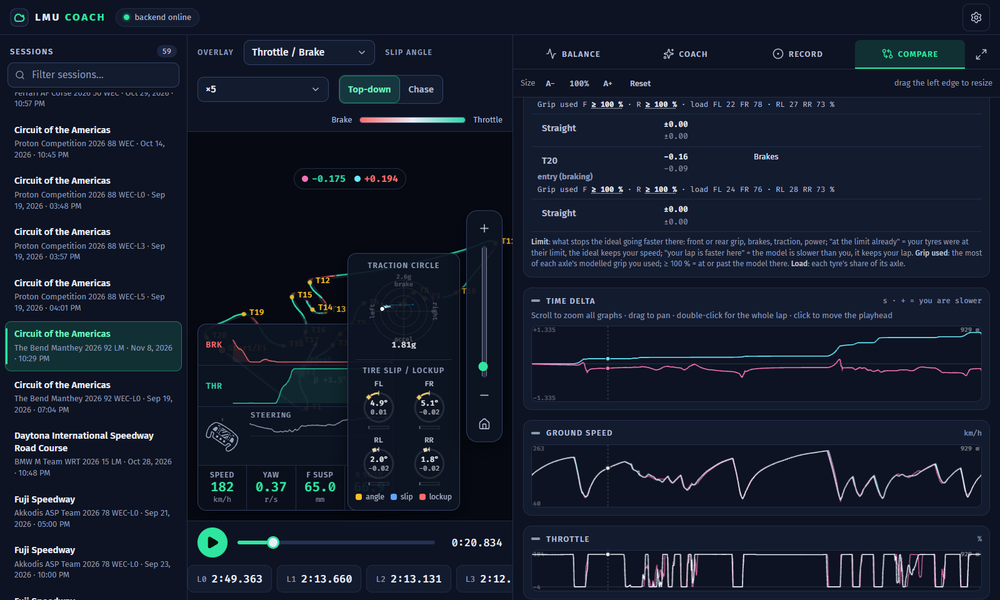
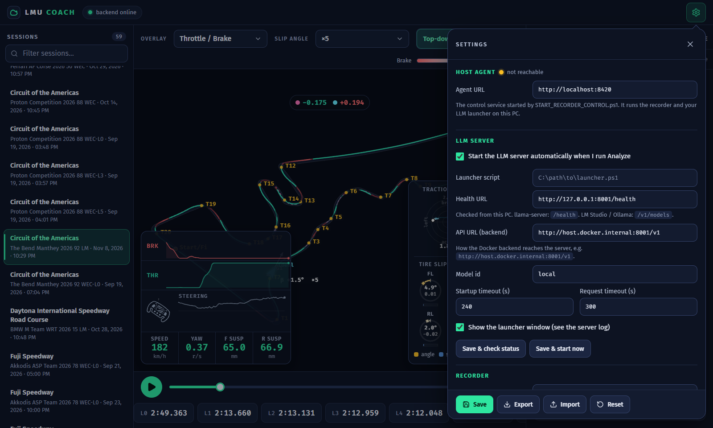
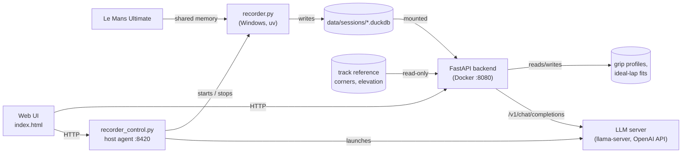

# lmu-coach

**A local, AI-assisted telemetry coach for Le Mans Ultimate.** It records the game's telemetry, shows each lap on a track map with playback and a 3D chase view, compares laps against ghosts, and solves an *ideal lap* for your car on your own line. A large language model running on your own PC turns the analysis into corner-by-corner coaching.

Everything runs on your machine. There is no cloud service, no account, and your laps never leave your PC.



> Status: personal project, under active development. It is built and tested by one driver on Windows 11, so expect rough edges. Not affiliated with Le Mans Ultimate, Studio 397 or Motorsport Games.

---

## Contents

- [Features](#features)
- [Screenshots](#screenshots)
- [Requirements](#requirements)
- [Installation](#installation)
- [How to use](#how-to-use)
- [Architecture](#architecture)
- [Methodology](#methodology)
- [Development](#development)
- [Known limitations](#known-limitations)
- [Roadmap](#roadmap)
- [License and credits](#license-and-credits)
- [Changelog](#changelog)

---

## Features

### Recorder
- Reads LMU's shared memory and writes **one DuckDB file per session**, in the same layout as LMU's own telemetry export. Those files also open in the community [telemetry visualizer](https://lamerman.github.io/telemetry-visualizer-for-lmu/).
- **Starts and stops by itself:** it records every session it finds, saves when you return to the garage or quit, and waits for the next one.
- **Follows the game's own updates** (~100 Hz, about 1 % of one CPU core) instead of polling in a busy loop. Every row is stamped with the game clock, and lap times are LMU's official 1 ms times. A save that missed more than 2 % of the updates prints a warning.
- **Safe saving:** it writes to a temporary file and renames it at the end, and keeps a safety copy that is recovered at startup. A crash or Ctrl+C does not lose the session.
- Records the channels LMU's own export lacks:
  - per-wheel slip angles, yaw rate, local velocities, suspension force, ride heights, camber, tyre temperatures (carcass and three zones), wear and pressures, plus tyre load and forces where the game provides them (Hypercars);
  - the car's height and orientation, and the other cars' positions (used by the 3D chase view and the track elevation);
  - brake pressure, brake bias and steering wheel range (driver inputs).
- `--probe N` measures how many game updates are caught and how much CPU the recorder uses, without recording.

### Lap viewer (web UI)
- **Session list** with filter, lap chips showing official lap times, and a BEST marker that skips partial laps.
- **Track map** drawn from GPS, with track edges from LMU's scoring data, corner names and numbers per circuit, zoom and pan, and a colour overlay of throttle/brake or other channels.
- **Playback scrubber** with a direction chevron. When the data allows, the chevron also shows **body slip β**, the angle between where the car points and where it travels. It is drawn larger than true scale so it is visible, while the label always shows the real value.
- **Driver-input HUD:** brake, throttle and steering traces, plus speed, yaw rate and front/rear suspension readouts.
- **Traction circle** with a trail, and **tyre gauges** showing slip angle, slip ratio and lockup per wheel.
- **Telemetry panel** with ground speed, ABS/TC events, yaw rate, axle balance and per-corner suspension graphs, plus statistics. It can be docked, floating and resized, and its text size can be changed.

### Chase view (3D)
- The lap seen from behind the car (three.js), on the track's measured elevation, banking and kerb / grass / gravel paint, with a simple model of each car class.
- Camera modes are a smoothed chase camera or one locked to the direction of travel. Options show track limits and tyre slip arrows.
- Ghost cars and their lines from the Compare tab appear in the 3D scene too.

### Compare (ghost laps)
- Up to **4 ghost laps** of the same track, class and layout, from this session or any other file. One-click buttons add "Best lap of this session", "Best other file, same class" and "Best other car, same class".
- **Live time delta** and ghost markers on the map, with the ghost placed either at the same elapsed time (shows the gap) or at the same distance (shows line differences).
- **Overlaid traces** of time delta, speed, throttle, brake, steering and line offset (how far each ghost's line is from yours) over your lap distance, with zoom, pan and click-to-scrub synced across all of them.
- Every recording of a track is placed in one shared coordinate frame, so lines from different sessions line up.

### Ideal lap
- **"How fast could this car go on the line I drove?"** For any lap, the app fits a physical model of your car from your recordings and solves the fastest speed profile on your own line (method below).
- Returns a range, not a single number. "At least" and "expected" are both shown with a confidence level, the setup's potential is shown separately, and the app **refuses with a reason** rather than guess when the data is too thin.
- A **per-corner table** shows the time available in each corner, where in the corner it is (entry, mid or exit), what limits the ideal there (front grip, rear grip, brakes, traction or power), the grip you used on each axle, and each tyre's share of the load.
- The ideal lap is drawn as an extra ghost on the map, in the traces and in the chase view.

### AI coach
- **Analyze** builds a compact report of the lap: grip use per axle, ABS/TC events, lockups and wheel slip, understeer/oversteer signatures, tyre temperatures and pressures, and input features per corner (brake point, release, throttle pick-up, steering). It sends that report, not raw telemetry, to a **local LLM** through any OpenAI-compatible server (llama.cpp's `llama-server`, LM Studio or Ollama).
- The coach follows a written **race-engineer method** (`backend/app/coach_skill/`):
  - find the habit, go to the contact patch, name one root cause using your own numbers;
  - give one fix, a feel cue and a drill;
  - say how confident it is and what data it lacked.
- Follow-up questions continue the same conversation.

### Tyre model and grip profiles
- A **per-car tyre model**: a Magic Formula fit with load sensitivity, built up across every lap you analyse. It gives a slip-angle peak with a 90 % interval and a confidence that comes from that interval, never from the sample count alone.
- **Grip utilisation** (how close to the tyre's peak you drove) and **cornering efficiency**, both flagged as upper or lower bounds when the peak was never reached.
- Profiles are stored as one JSON file per car model and rebuilt by a bulk ingest tool.

### Keep laps
- Cut single laps out of a long session into their own small, checked files ("Kept laps"). After every kept lap has passed its check, the original recording can be **deleted deliberately**. Deleting needs a confirmation that names the file and is refused if any kept lap is missing or fails the check.

### Host agent and settings
- A small service on your PC (`recorder_control.py`, port 8420) lets the web UI start and stop the recorder, stream its log, and **start your LLM server on demand** when you press Analyze. It only accepts requests from localhost and from the allowed origins.
- A **settings panel** for the LLM URL, model and timeouts, the launcher script and folders, with JSON import/export. It can generate the `docker-compose` path lines for you.

### Tools
Command-line tools on the backend code, each with a PowerShell wrapper in `backend/tools/`. They cover: bulk ingest of grip profiles, tyre-model validation, ideal-lap validation, building the track reference and elevation, importing public lap times, lap listing and tyre-force checks. See [`backend/tools/README.md`](backend/tools/README.md).

---

## Screenshots

| | |
|---|---|
|  |  |
| **Chase view.** The lap in 3D with kerbs, the body-slip chevron and tyre slip. | **Compare and ideal lap.** A ghost lap and the ideal lap on the map, with the ideal-lap range and its confidence. |
|  |  |
| **Compare traces.** The per-corner ideal-lap table, then time delta, speed and throttle against the ghosts (panel widened). | **Settings.** Host agent, LLM server auto-start, recorder and folders. |

<details>
<summary>Example coach output (excerpt, BMW M4 LMGT3 at Fuji)</summary>

> **Dunlop Chicane exit → climb → T16 — throttle-on — est. 0.25 s**
>
> ▸ *What the data shows:* TC fires at 73–100 % across the chicane exit, the climb and T16; peak rear wheel slip is 0.122 vs 0.078 on the fronts; and the front–rear slip difference peaks at +6.16° (fronts slipping more) right between two of those TC zones.
>
> ▸ *What the tires are doing:* the rears are being asked for more than they have, so TC is chopping the power, and the fronts are past their best slip angle while you're still steering into the turn on power.
>
> ▸ *Fix:* finish more of the turn on the entry (brake release + engine braking + less steering), then on exit pour the throttle in one smooth application with a lower first %.
>
> ▸ *Feel cue:* the rears should light up and settle into a continuous hum, and the car should straighten itself under the throttle rather than you steering it straight.

</details>

---

## Requirements

| | |
|---|---|
| OS | **Windows 10/11.** The recorder reads LMU's shared memory, which is Windows-only. The backend runs in Docker. |
| Game | Le Mans Ultimate. The shared memory interface is built into the game, so no plugin is needed. |
| Docker | Docker Desktop (runs the backend: Python 3.12, FastAPI). |
| Python | [uv](https://docs.astral.sh/uv/). It installs Python 3.13 and the recorder's dependencies for you. |
| LLM (optional, for the coach) | Any OpenAI-compatible server. Developed with llama.cpp `llama-server` and a Qwen 27B Q4 model on an RX 7900 XTX. Smaller models work but coach less well. |

The lap viewer, compare tab and ideal lap work without an LLM. Only the Coach tab needs one.

## Installation

1. **Clone the repo**
   ```powershell
   git clone https://github.com/nhatxart/lmu-coach.git
   cd lmu-coach
   ```
2. **Choose where recordings go.** Copy the example env file and set the folder:
   ```powershell
   copy .env.example .env
   # edit .env:  LMU_TELEMETRY_PATH=./data/sessions   (the recorder's default output)
   ```
   Optional overrides in `.env`: `REFERENCE_LAPS_PATH` (kept laps), `GRIP_PROFILES_PATH`, `TRACK_REFERENCE_PATH`, `LLM_BASE_URL`, `LLM_MODEL`.
3. **Start the backend**
   ```powershell
   docker compose up -d --build
   ```
   Open **http://localhost:8080**. After pulling a new version, run `docker compose down; docker compose up -d --build` so you don't keep an old container.
4. **(Optional) Host agent and LLM auto-start.** Copy the example config and fill in your LLM launcher:
   ```powershell
   copy lmu-coach.config.example.json lmu-coach.config.json
   ```
   Set `llm.launcher_path` to a script that starts your server. Set `llm.health_url` and `llm.backend_base_url` to its port: `127.0.0.1` from the PC, `host.docker.internal` from the container. Everything can also be set in the web UI's **Settings**.
5. **(Optional) Track reference.** Corner names and track elevation for the circuits in your recordings:
   ```powershell
   backend\tools\BUILD_TRACK_REFERENCE.ps1
   ```

## How to use

1. **Record.** Start the recorder before or while you drive:
   ```powershell
   recorder\START_RECORDER.ps1            # standalone
   # or
   recorder\START_RECORDER_CONTROL.ps1    # host agent: Record tab + LLM auto-start in the web UI
   ```
   Run one of them, not both. Drive normally. Each session is saved when you go back to the garage or quit. Stop the recorder with Ctrl+C, or with the Record tab's Stop button when you use the host agent.
2. **Open a lap.** Pick a session in the left list, then a lap chip at the bottom. The fastest complete lap is selected by default. Press play or drag the scrubber, switch **Top-down / Chase**, and change the map overlay at the top.
3. **Coach.** On the **Coach** tab press **Analyze**. With auto-start on, your LLM server is started first. Read the corner-by-corner advice and ask follow-up questions in the same tab.
4. **Compare.** On the **Compare** tab, add ghosts with the quick buttons or pick any file and lap. Use **Same time / Same distance** to switch between seeing the gap and seeing line differences. Scroll on a trace to zoom all of them, and click a trace to move the playhead.
5. **Ideal lap.** On the **Compare** tab press **Ideal lap (this car, this line)**. The first request for a car and track can take up to ~15 s; after that it comes from the cache. Read the range, the confidence and the per-corner table, and look at where the ideal ghost pulls away.
6. **Keep laps.** **Keep laps…** at the end of the lap bar turns the chips into toggles. Each selected lap is saved as its own checked file in *Kept laps*. Once all kept laps have passed the check, you can delete the long original recording.

Useful recorder options: `--probe 30` (measure caught updates and CPU, records nothing), `--poll-hz 1000` (fixed-rate polling, more CPU), `--recover` (convert a leftover safety copy), `--output-dir <folder>`.

---

## Architecture



| Component | Where | What it does |
|---|---|---|
| `recorder/recorder.py` | Windows host | Reads shared memory, buffers a session, and writes DuckDB via CSV + `COPY` (much faster than row inserts). |
| `recorder/recorder_control.py` | Windows host, :8420 | Host agent: recorder process and log stream, config file, LLM health check and launch. It exists because a Docker container cannot read Windows shared memory or start programs on the host. |
| `backend/app/main.py` | Docker, :8080 | Endpoints: sessions, laps, `/trackmap` (map, line and per-point channels), `/ideal-lap`, `/analyze` (+ follow-up), keep and delete. |
| `backend/app/telemetry.py` | backend | Loads recorder files and LMU's own exports alike: lap boundaries, time axes, channel resampling. |
| `grip_analysis.py`, `corner_features.py`, `coach.py` | backend | The coaching report, per-corner input features and the LLM prompt. |
| `tire_*.py`, `grip_profile.py` | backend | Tyre model v3 and per-car profiles. |
| `ideal_state.py`, `ideal_car.py`, `ideal_solver.py`, `ideal_store.py`, `ideal_lap.py` | backend | Ideal lap: lap reductions, car fit, speed solver, fit groups and cache, endpoint. |
| `track_*.py`, `vehicle_pose.py`, `trackmap_elevation.py` | backend | Corner names, centre lines, elevation and banking, orientation convention, 3D surface. |
| `backend/app/static/index.html` | browser | The whole UI in one file: vanilla JS + canvas, with three.js and GSAP vendored and loaded only for the chase view. No build step. |

Data: `data/sessions/` (recordings), `data/reference_laps/` (kept laps), `data/grip_profiles/` (per-car JSON and ideal-lap fits), `data/track_reference/` (corners, topography; built by the tool, read-only at run time).

---

## Methodology

The app follows one rule throughout: **say what was measured, what was estimated, and refuse rather than guess.** Every model below reports its confidence and has a defined way of saying "not enough data".

### Time base and laps
- The master clock is the game's `mElapsedTime` (~100 Hz). The scoring clock updates at only ~5 Hz and would round lap times to 0.1 s. Lap times are LMU's official `mLastLapTime` (1 ms).
- Position is 10 Hz and most channels 100 Hz. Every channel is interpolated to the full session length first and cut to the lap last, which avoids length mismatches and edge effects at the lap boundaries.
- Yaw rate and slip-angle signals are low-pass filtered (8 Hz, 2nd-order Butterworth, zero phase) at their native rate before slicing. The real signal is below 1 Hz; the noise above 3-5 Hz is physics jitter.

### Track map and coordinates
- GPS is projected to metres around a **fixed origin per track**, so every recording of a track shares one frame and laps from different days line up. LMU's GPS is not the real world: every circuit sits around one point near Fuji.
- Only latitude is negated in the projection (a mirror). Negating both axes would be a 180° rotation, which is the bug that made Road Atlanta run the wrong way early on.

### Body slip β
- β = heading from the integrated yaw rate − direction of travel from position, calibrated on the straights. When the recorder logged local velocities, β = atan2(vx, −vz) directly.
- The fit refuses when the data cannot calibrate it: too few straight or fast samples, a residual over 4°, or too many outliers. On a synthetic car with known β it was accurate to 0.09° RMS.

### Grip and tyre model
- LMU does not publish tyre forces for GT3 cars, so grip is measured relative to the tyre's own curve: **grip utilisation** = the lap's 95th-percentile slip angle ÷ the fitted peak slip angle. The 95th percentile is used because single-sample spikes dominate the maximum.
- **Tyre model v3:** each lap is reduced to binned statistics (slip, load ratio, temperature, pressure, wear, camber). A factorised Magic Formula is then fitted, with only the load factor enabled, because the other factors did not hold up on held-out laps.
  - Load comes from Tire Load on Hypercars and from Susp Force on GT3s.
  - A bootstrap over laps gives a 90 % interval on the peak.
  - On held-out laps the model beats a plain slip-binned curve on every axle that could be scored.

### Ideal lap
- **Car model, fitted from your recordings:**
  - a load model per wheel;
  - axle grip with load and speed terms, learned from the samples where an axle was saturated (slip-angle knee or Grip Fraction);
  - braking and traction limits, drag (fitted where tyre forces exist, else a class prior), and the engine's measured acceleration.
- **Solver:** a quasi-steady speed solve on a 2 m grid along **your own driven line**. Its curvature, grade and vertical curvature come from the lap. Forward and backward passes find where each axle, the brakes, traction or power limits the speed.
- **Clamps:** where your tyres were already at their limit, the ideal keeps your speed. Where you were flat out, the measured acceleration at that place is used. As a result, the ideal only finds time where you left grip unused.
- **Levels:** "at least", "expected" and the upper range come from the uncertainty of the grip level, and "setup potential" is a separate ceiling. The ideal is flagged as low confidence when it beats public lap times for the car.
- **Validation:** a synthetic "perfect driver" (a known car driven at its limit with realistic grip noise) must be recovered by the fit. Held-out real laps go through a validation report (`IDEAL_LAP_REPORT.ps1`).

### Coaching
- The LLM never sees raw telemetry. It gets a compact JSON report and a system prompt built from the coaching method in `coach_skill/` (method, diagnostics, voice, one worked example), plus the tyre model's confidence.
- The coach is told to estimate time gains, say what it could not confirm, and give one change at a time.

---

## Development

```powershell
# backend tests (from the repo root; the backend's own deps live in Docker)
uv run --no-project --with pytest --with fastapi --with duckdb --with numpy `
    --with scipy --with httpx --with pydantic python -m pytest backend/tests -v
# the browser tests in backend/tests/ui also need: --with playwright --with uvicorn
# (and a Playwright Chromium); without them they skip cleanly
# recorder tests
cd recorder; uv run python -m unittest test_recorder
```

- `docs/superpowers/specs/` and `docs/superpowers/plans/` hold the design notes and implementation plans of each feature.
- `docs/HANDOFF.md` is the technical handover: decisions and their reasons, channel meanings, known quirks.
- `DevNotes.md` is the dated development log.
- `DESIGN.md` describes the UI's design tokens and accessibility rules.
- UI changes stay inside `backend/app/static/index.html`. There is no framework and no build.

## Known limitations

- **Windows only for recording.** The backend and UI run anywhere Docker runs.
- **Limited data in LMU's own exports:** they lack slip angles and yaw rate, so body slip, the tyre model and the ideal lap need files from this recorder.
- **No tyre forces on GT3 cars:** LMU publishes tyre load and forces for Hypercars only, so GT3 grip is estimated from suspension force.
- **Rough edges in the tyre model:** some rear axles (Porsche, Ferrari, Cadillac) score weakly on held-out laps.
- **Fixed line:** the ideal lap is solved on your own line. It does not search for a better racing line.
- **LLM-dependent coaching:** the coach is only as good as the local model behind it.

## Roadmap

- **Ideal inputs:** the brake, throttle and steering-reference traces that would drive the ideal lap, with per-corner advice such as "Brake 8 m later, release 6 m later". The design and plan are in `docs/superpowers/`.
- Use the new brake bias, brake pressure and steering-range channels so input maps carry across setups.
- A live HUD marker for the ideal pedal while scrubbing.

## License and credits

[GPL-3.0](LICENSE).

- `recorder/pyLMUSharedMemory` is a vendored copy of the Python mapping of LMU's shared memory interface, based on S397's header and Tony Whitley's [pyRfactor2SharedMemory](https://github.com/TonyWhitley/pyRfactor2SharedMemory).
- [three.js](https://threejs.org/) (MIT) and [GSAP](https://gsap.com/) (standard no-charge license) are vendored in `backend/app/static/vendor/`.
- Fira Sans and Fira Code are bundled under the SIL Open Font License.
- The coaching method is inspired by the teaching approach of Suellio Almeida (Almeida Racing Academy). The coach does not claim to be him and does not quote his material.
- Le Mans Ultimate is a trademark of its owners. This project is not affiliated with them.

---

## Changelog

Newest first. Dates are when the work landed. Detail is in `DevNotes.md` and the git history.

### 2026-11-27
- Implementation plan for **ideal inputs** (phase 1-lite): brake/throttle/steering maps, reproduce checks, per-corner input lines.
- Project published on GitHub.

### 2026-11-26
- **Recorder:** brake pressure (per wheel), rear brake bias and steering wheel range are recorded (new recordings only).
- **Ideal lap:** corner rows use the map's corner labels; each row says where in the corner the time is.

### 2026-11-24
- **Ideal lap UI:** the ideal lap is a ghost in the Compare tab, with its range, confidence and a per-corner table (corner names, what limits the ideal there, grip used, tyre load share).
- Design and probes for ideal inputs.

### 2026-11-22 – 11-23
- **Ideal lap, validation round 1:**
  - measured engine power on the line;
  - grip level at the 0.75 quantile;
  - setup "ceiling" rooms;
  - low confidence on a wide self-check spread;
  - braking and traction limits at fitted quantiles, with a traction envelope guard;
  - validation report rows, and older recorder files excluded from the gate.
- **Keep laps UI:** Keep laps… on the lap bar, a dialog with per-lap results, a "Kept laps" group, and Delete with a warning.

### 2026-11-16 – 11-17
- **Ideal lap:** fit groups per car and track, a profile store and an ingest pass; the saturation clamp; a setup fingerprint and per-file grip trim; offline public lap times; the `/ideal-lap` endpoint and validation tool.
- **Delete an original recording**, only with a confirmation and only after its kept laps have passed their checks.

### 2026-11-09 – 11-12
- **Ideal lap:** feasibility study, design, per-lap state, per-file load model, car fit, and a balanced/ceiling speed solver.
- **Keep laps backend:** a lap is cut into its own checked file, with tyre context from the original and no double counting.
- **Compare:** a "Best other car, same class" button.

### 2026-11-04 – 11-08
- **Compare tab:** up to 4 ghost laps, a live time delta, ghost lines and markers on the map, overlaid traces with synced zoom/pan/scrub, and ghost cars in the chase view.
- **One coordinate frame per track**, so laps from different files line up; game lap distance and time per map point.
- **Session index** (track, class, layout, laps per file) and complete/real lap flags; BEST skips partial laps.
- **Telemetry panel:** size control, docked width handle, floating frame resizable from every edge.

### 2026-10-25 – 10-27
- **Chase view (3D):** three.js scene behind a Top-down/Chase switch, with an animated transition, a smoothed or direction-locked camera, car models per class, track limits, and tyre slip arrows with front-wheel steer.
- **Track topography:** the recorder logs height, orientation and other cars' positions; elevation, banking and kerb/grass/gravel paint are built per track from the recordings.

### 2026-10-21
- **Track reference:** corners, complexes and names per circuit, without an LLM.
- **Recorder:** follows the game's updates (~1 % CPU) instead of busy polling at 1000 Hz, runs at normal priority, and warns when a recording lost updates.

### 2026-10-18 – 10-19
- **Tyre model v3:** per-lap binned statistics, a factorised Magic Formula fit with bootstrap confidence, a class-pooled prior, and profiles keyed by car model. Its outputs are wired into `/analyze` and the coach prompt.
- **Coach:** the race-engineer coaching method (method, diagnostics, voice, few-shot example).
- **Car identity** (model, class, game version) and the extra tyre channels in the backend.
- **One recorder:** the high-frequency recorder becomes `recorder.py`, and the older recorder and launcher are retired.
- Tyre forces documented by class (Hypercars yes, GT3s no); GT3s use suspension force for load.

### 2026-10-12 – 10-14
- Development moved from a chat prototype to a versioned repo with tests.
- **High-frequency recorder:** one sample per game tick, extra tyre channels, official 1 ms lap times. First in-game run: 19 laps at Fuji.
- Time axes rebuilt from the recorder's own clock, which fixed map and telemetry misalignment after skipped game ticks.
- Body slip from local velocities; signed per-wheel slip angles; tyre gauges show the slip direction.
- **Tyre model v2:** every qualifying lap is folded in, with steady-state samples only and load-normalised grip.

### 2026-09 – early 10
- **First versions:** the shared-memory recorder writing DuckDB in LMU's export layout; the FastAPI backend; the single-page UI with track map, playback scrubber, input HUD and lap chips.
- **Saving:** CSV + `COPY` bulk saving, a stop file and atomic writes, so sessions survive Ctrl+C.
- **Map and signals:** map mirroring fixed; 8 Hz filter on yaw and slip; dynamic chart ranges; ground speed, ABS/TC, yaw and axle balance graphs.
- **Grip and coaching:** grip utilisation, traction circle and the first probabilistic tyre model; the local LLM coach (Ollama, then llama.cpp).
- **UI:** a settings panel with config import/export and LLM auto-start, a full visual redesign (Fira fonts, design tokens, WCAG AA), and the body-slip β chevron.
